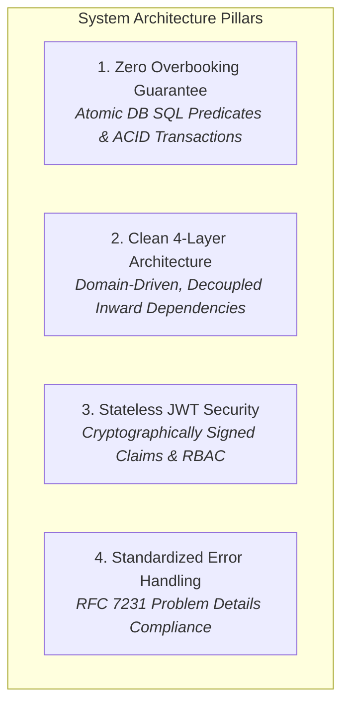
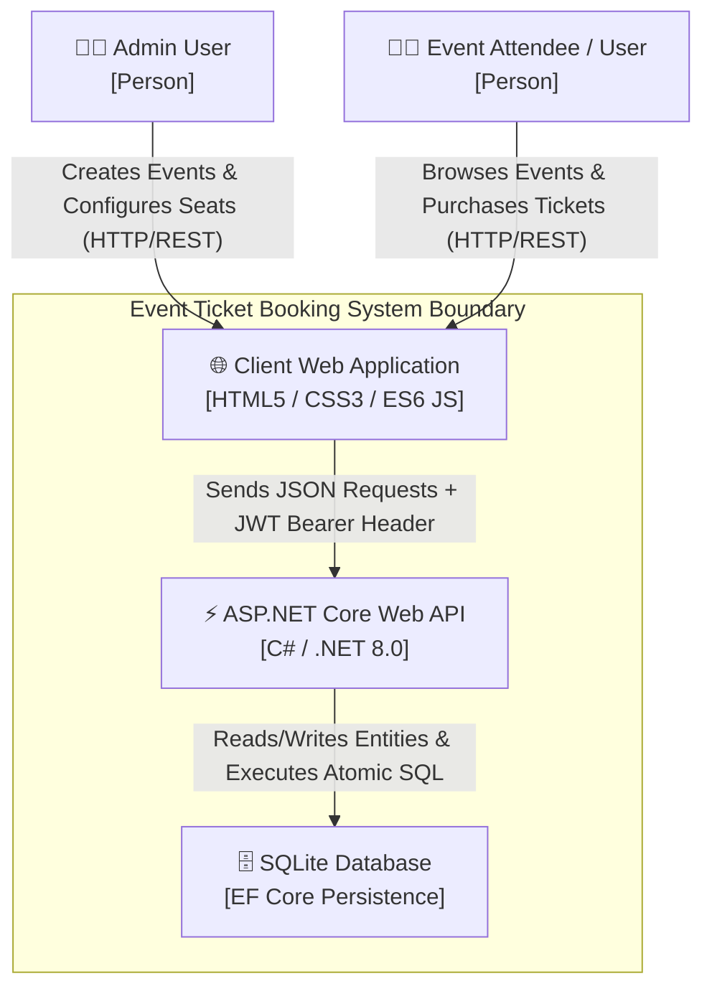
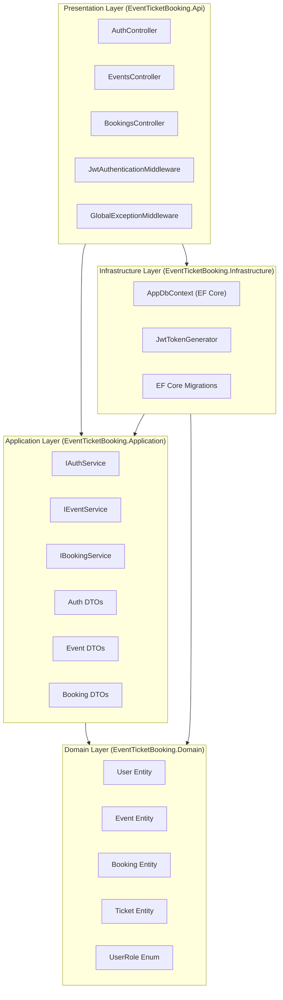
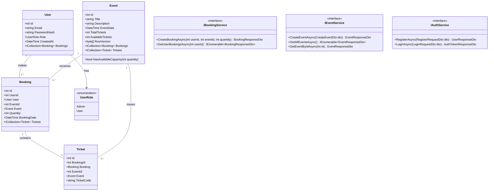
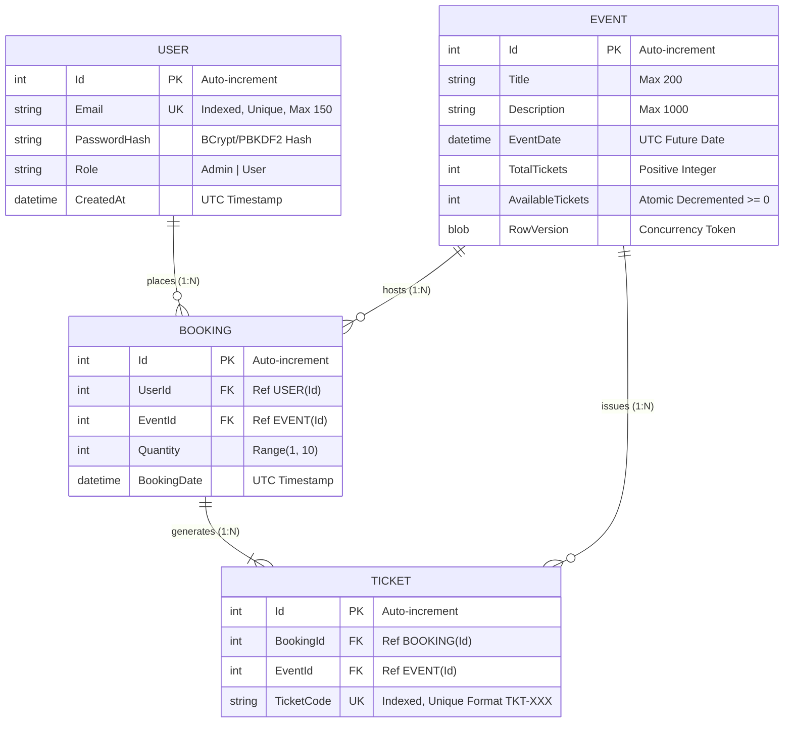
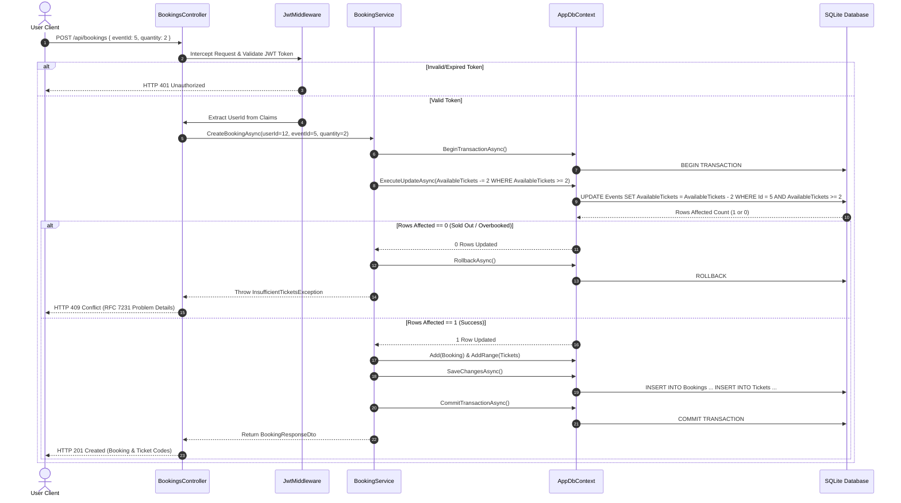
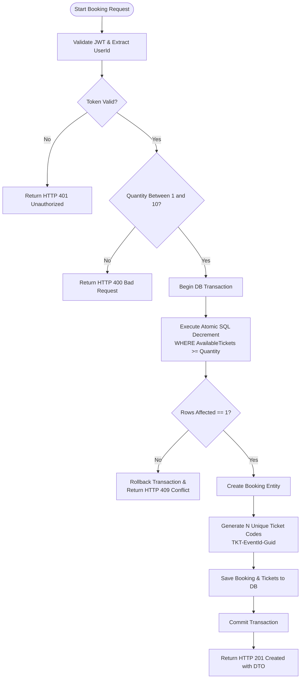
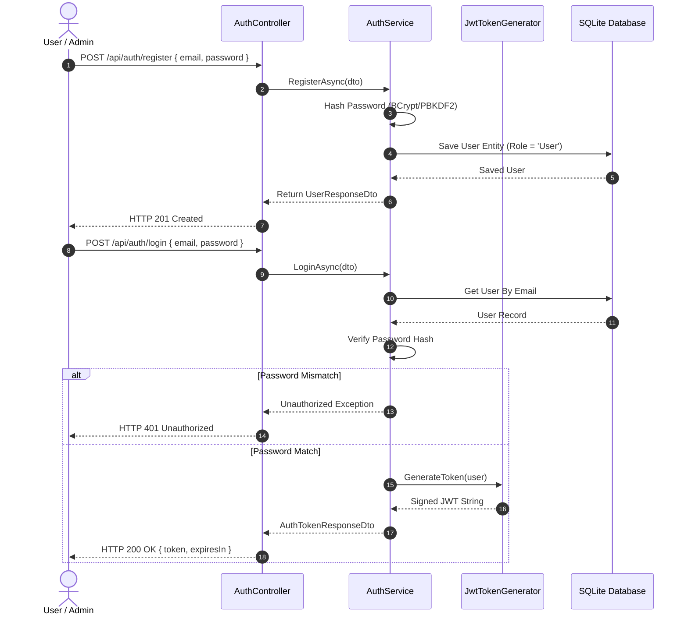
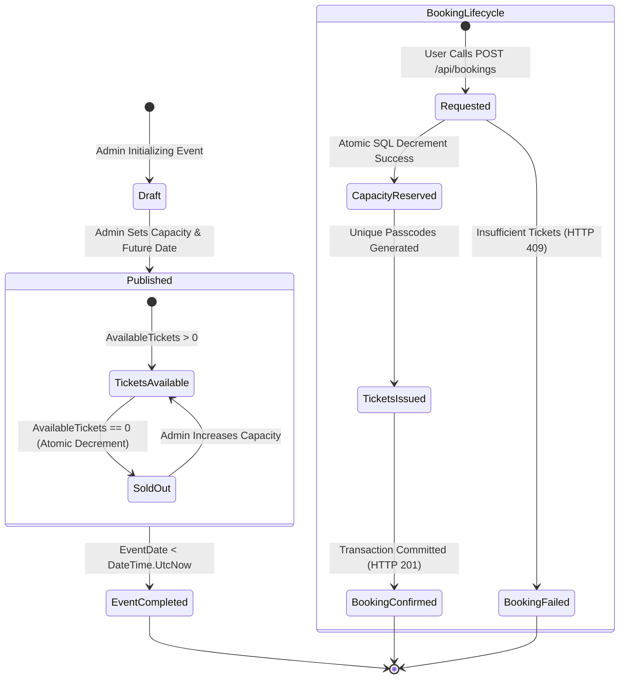

# Event Ticket Booking System — Comprehensive Technical Specification & Architectural README

> **Software Engineering Semester Project** | *University of Engineering and Technology (UET)*  
> **Date:** October 2026  
> **Authors:**  
> - **Hammad Aslam** — `2025(S)-SE-25`  
> - **Irfan Shoukat** — `2025(S)-SE-04`  

---

## 📋 Master Table of Contents
1. [Core Idea, Domain Problem & System Philosophy](#1-core-idea-domain-problem--system-philosophy)
   - [1.1 The Real-World Ticket Concurrency Challenge](#11-the-real-world-ticket-concurrency-challenge)
   - [1.2 Naive Read-Modify-Write vs. Production Atomic Strategy](#12-naive-read-modify-write-vs-production-atomic-strategy)
   - [1.3 System Vision & Four Pillars of Reliability](#13-system-vision--four-pillars-of-reliability)
   - [1.4 End-to-End System Lifecycle & Usage Phases](#14-end-to-end-system-lifecycle--usage-phases)
2. [High-Level System Architecture & C4 Visual Models](#2-high-level-system-architecture--c4-visual-models)
   - [2.1 C4 Context Diagram](#21-c4-context-diagram)
   - [2.2 C4 Container & Layered Architecture Diagram](#22-c4-container--layered-architecture-diagram)
3. [Domain Design & Complete UML Class Diagram](#3-domain-design--complete-uml-class-diagram)
   - [3.1 Domain-Driven Design (DDD) Principles](#31-domain-driven-design-ddd-principles)
   - [3.2 Complete UML Class Diagram](#32-complete-uml-class-diagram)
4. [Database Architecture & Entity-Relationship Model](#4-database-architecture--entity-relationship-model)
   - [4.1 Database Design & Fluent API Mapping](#41-database-design--fluent-api-mapping)
   - [4.2 Comprehensive Entity-Relationship Diagram (ERD)](#42-comprehensive-entity-relationship-diagram-erd)
   - [4.3 Entity Schema Specifications & Data Dictionaries](#43-entity-schema-specifications--data-dictionaries)
5. [High-Concurrency & Transaction Execution Engine](#5-high-concurrency--transaction-execution-engine)
   - [5.1 Race Condition Analysis & Mathematical Model](#51-race-condition-analysis--mathematical-model)
   - [5.2 Atomic Predicate Decrements & ACID Isolation](#52-atomic-predicate-decrements--acid-isolation)
   - [5.3 High-Concurrency Booking Sequence Diagram](#53-high-concurrency-booking-sequence-diagram)
   - [5.4 Booking Decision Tree & Activity Flowchart](#54-booking-decision-tree--activity-flowchart)
6. [Security, Authentication & Role-Based Authorization](#6-security-authentication--role-based-authorization)
   - [6.1 Stateless JWT Security Architecture](#61-stateless-jwt-security-architecture)
   - [6.2 Authentication Lifecycle Sequence Diagram](#62-authentication-lifecycle-sequence-diagram)
   - [6.3 Middleware Request Pipeline Diagram](#63-middleware-request-pipeline-diagram)
   - [6.4 Role-Based Access Control (RBAC) Matrix](#64-role-based-access-control-rbac-matrix)
7. [State Machine & Life Cycles](#7-state-machine--life-cycles)
   - [7.1 Event & Ticket State Machine Diagram](#71-event--ticket-state-machine-diagram)
8. [REST API Endpoint Catalog & Contract Specifications](#8-rest-api-endpoint-catalog--contract-specifications)
   - [8.1 API Catalog Summary Table](#81-api-catalog-summary-table)
   - [8.2 Detailed Endpoint Payload Contracts & Schemas](#82-detailed-endpoint-payload-contracts--schemas)
   - [8.3 RFC 7231 Problem Details Error Specifications](#83-rfc-7231-problem-details-error-specifications)
9. [Solution Directory Blueprint & File Map](#9-solution-directory-blueprint--file-map)
10. [Step-by-Step Setup, Deployment & Execution Guide](#10-step-by-step-setup-deployment--execution-guide)
11. [Automated Testing Strategy & Verification](#11-automated-testing-strategy--verification)

---

## 1. Core Idea, Domain Problem & System Philosophy

### 1.1 The Real-World Ticket Concurrency Challenge

In digital event ticketing platforms (hosting concerts, sports events, or tech conventions), the defining engineering challenge is **handling high-concurrency ticket reservations without overbooking physical venue seats**.

When a high-demand event opens for registration, thousands of HTTP requests hit the backend application server within the same second. Under traditional read-modify-write patterns, race conditions occur:

```
User A (Req 1) ───► Read AvailableTickets = 1 ────────────────────────► Decrement & Save (AvailableTickets = 0)
                                                                            │
User B (Req 2) ───► Read AvailableTickets = 1 ──► Decrement & Save ────────┴──► (AvailableTickets = -1) [Oversold!]
```

Without strict atomicity and transaction boundaries:
- Two or more users are sold the same physical ticket.
- Database records desynchronize (e.g. inventory counter decrements, but ticket generation crashes mid-flight).
- Standard users attempt to tamper with administrative capabilities or access tickets belonging to other accounts.

---

### 1.2 Naive Read-Modify-Write vs. Production Atomic Strategy

| Architectural Vector | Naive / Flawed Implementation | Production-Grade ASP.NET Core Solution |
| :--- | :--- | :--- |
| **Inventory Update Strategy** | `event.AvailableTickets -= quantity;` followed by `_context.SaveChangesAsync();` | **Atomic SQL Predicate:** `ExecuteUpdateAsync` with `WHERE Id == eventId AND AvailableTickets >= quantity` executed at DB engine level. |
| **Transaction Boundaries** | Non-transactional, independent SQL queries across tables | **ACID Explicit Transaction:** `IDbContextTransaction` wrapping capacity deduction, booking insertion, and ticket generation. |
| **Architectural Pattern** | Monolithic controllers mixing UI, DB queries, and logic | **Clean 4-Layer Architecture:** Presentation -> Infrastructure -> Application -> Domain with inverted dependencies. |
| **Authentication** | Server-side stateful sessions or unencrypted user IDs | **Stateless Cryptographic JWT:** Bearer tokens containing signed `Sub`, `Email`, and `Role` claims validated via middleware. |
| **Concurrency Safeguard** | No locking or basic soft checks | **Hybrid Isolation:** Atomic DB-level decrements for inventory + EF Core `RowVersion` Optimistic Concurrency for event metadata. |

---

### 1.3 System Vision & Four Pillars of Reliability



1. **Zero Overbooking Guarantee:** Guarantees that under no concurrent workload can `AvailableTickets` drop below zero.
2. **Clean 4-Layer Architecture:** The Domain Layer contains pure C# logic with zero external dependencies on EF Core, SQLite, or ASP.NET Core.
3. **Stateless JWT Security:** Completely eliminates server-side session state overhead while ensuring role-based protection (`Admin` vs `User`).
4. **Standardized Error Handling:** All API error responses return structured RFC 7231 Problem Details objects with trace identifiers.

---

### 1.4 End-to-End System Lifecycle & Usage Phases

1. **Phase 1: Event Publishing (Admin):** Admins publish events with titles, future dates, descriptions, and total seat capacities.
2. **Phase 2: Authentication & Discovery (User):** Users register, log in to receive signed JWT bearer tokens, and browse active upcoming events.
3. **Phase 3: High-Concurrency Reservation (Execution):** Users request $N$ tickets (1–10 per order). The system executes an atomic capacity decrement inside a database transaction, generates unique alphanumeric ticket passcodes, and commits the order.
4. **Phase 4: Order Verification:** Users retrieve personal ticket histories and present unique ticket passcodes for venue check-in.

---

## 2. High-Level System Architecture & C4 Visual Models

### 2.1 C4 Context Diagram

The C4 Context diagram illustrates the system boundaries, external actors, and key platform interactions.



---

### 2.2 C4 Container & Layered Architecture Diagram

The system adheres strictly to Clean Architecture dependency rules. Inner layers are isolated from outer implementation details.



---

## 3. Domain Design & Complete UML Class Diagram

### 3.1 Domain-Driven Design (DDD) Principles

- **Entities:** Objects with unique identities (`User`, `Event`, `Booking`, `Ticket`).
- **Value Objects / Enums:** Immutable domain concepts (`UserRole`: `Admin`, `User`).
- **Domain Guard Rules:**
  - An event date cannot be set in the past.
  - Requested booking quantity must be greater than zero and must not exceed the maximum allowed limit per request (10 tickets).
  - Ticket codes must follow the deterministic format `TKT-{EventId}-{GuidSubstring}`.

---

### 3.2 Complete UML Class Diagram



---

## 4. Database Architecture & Entity-Relationship Model

### 4.1 Database Design & Fluent API Mapping

The database is built using EF Core Code-First with SQLite. Key configurations applied in `AppDbContext`:
- **Unique Indexes:** `User.Email` and `Ticket.TicketCode`.
- **Foreign Keys:** Cascade delete configured for `Booking -> Tickets` and `Event -> Tickets`.
- **Concurrency Tokens:** `Event.RowVersion` configured as `.IsRowVersion()`.

---

### 4.2 Comprehensive Entity-Relationship Diagram (ERD)



---

### 4.3 Entity Schema Specifications & Data Dictionaries

#### Table: `Users`
| Column Name | Data Type | Nullable | Key / Index | Constraint / Default |
| :--- | :--- | :---: | :---: | :--- |
| `Id` | `INTEGER` | ❌ No | `PK` | Auto-Increment |
| `Email` | `TEXT` | ❌ No | `UK, Index` | Unique, Valid Email format, Max 150 chars |
| `PasswordHash` | `TEXT` | ❌ No | None | Hashed String |
| `Role` | `TEXT` | ❌ No | None | Values: `'Admin'`, `'User'` |
| `CreatedAt` | `TEXT` | ❌ No | None | Default UTC Timestamp |

#### Table: `Events`
| Column Name | Data Type | Nullable | Key / Index | Constraint / Default |
| :--- | :--- | :---: | :---: | :--- |
| `Id` | `INTEGER` | ❌ No | `PK` | Auto-Increment |
| `Title` | `TEXT` | ❌ No | None | Max 200 chars |
| `Description` | `TEXT` | ✅ Yes | None | Max 1000 chars |
| `EventDate` | `TEXT` | ❌ No | Index | UTC Timestamp > `DateTime.UtcNow` |
| `TotalTickets` | `INTEGER` | ❌ No | None | Value > 0 |
| `AvailableTickets` | `INTEGER` | ❌ No | Index | Value >= 0 |
| `RowVersion` | `BLOB` | ❌ No | Concurrency | SQLite byte[] timestamp |

#### Table: `Bookings`
| Column Name | Data Type | Nullable | Key / Index | Constraint / Default |
| :--- | :--- | :---: | :---: | :--- |
| `Id` | `INTEGER` | ❌ No | `PK` | Auto-Increment |
| `UserId` | `INTEGER` | ❌ No | `FK` | References `Users(Id)` |
| `EventId` | `INTEGER` | ❌ No | `FK` | References `Events(Id)` |
| `Quantity` | `INTEGER` | ❌ No | None | Range: `1` to `10` |
| `BookingDate` | `TEXT` | ❌ No | None | Default UTC Timestamp |

#### Table: `Tickets`
| Column Name | Data Type | Nullable | Key / Index | Constraint / Default |
| :--- | :--- | :---: | :---: | :--- |
| `Id` | `INTEGER` | ❌ No | `PK` | Auto-Increment |
| `BookingId` | `INTEGER` | ❌ No | `FK` | References `Bookings(Id)` |
| `EventId` | `INTEGER` | ❌ No | `FK` | References `Events(Id)` |
| `TicketCode` | `TEXT` | ❌ No | `UK, Index` | Unique string format: `TKT-{EventId}-{GUID}` |

---

## 5. High-Concurrency & Transaction Execution Engine

### 5.1 Race Condition Analysis & Mathematical Model

Let $C$ be the available capacity of an event (`AvailableTickets`), and let $q_i$ be the requested ticket quantity for concurrent request $i$.

Under naive read-then-write:
$$C_{\text{final}} = C_{\text{initial}} - \sum_{i=1}^{N} q_i$$
If $\sum q_i > C_{\text{initial}}$, $C_{\text{final}} < 0$, leading to **overbooking**.

Our atomic update enforces the invariant:
$$\text{Update Succeeded} \iff C_{\text{current}} \ge q_i$$

---

### 5.2 Atomic Predicate Decrements & ACID Isolation

```csharp
// Executed within an explicit EF Core transaction boundary
using var transaction = await _context.Database.BeginTransactionAsync(IsolationLevel.Serializable);
try
{
    // Atomic SQL UPDATE: UPDATE Events SET AvailableTickets = AvailableTickets - @qty WHERE Id = @eventId AND AvailableTickets >= @qty
    int rowsAffected = await _context.Events
        .Where(e => e.Id == eventId && e.AvailableTickets >= quantity)
        .ExecuteUpdateAsync(s => s.SetProperty(
            e => e.AvailableTickets, 
            e => e.AvailableTickets - quantity
        ));

    if (rowsAffected == 0)
    {
        throw new InsufficientTicketsException("Event is sold out or requested quantity exceeds available capacity.");
    }

    // Insert Booking Record
    var booking = new Booking
    {
        UserId = userId,
        EventId = eventId,
        Quantity = quantity,
        BookingDate = DateTime.UtcNow
    };
    _context.Bookings.Add(booking);
    await _context.SaveChangesAsync();

    // Generate Individual Unique Tickets
    for (int i = 0; i < quantity; i++)
    {
        _context.Tickets.Add(new Ticket
        {
            BookingId = booking.Id,
            EventId = eventId,
            TicketCode = $"TKT-{eventId}-{Guid.NewGuid().ToString("N")[..8].ToUpper()}"
        });
    }
    await _context.SaveChangesAsync();

    await transaction.CommitAsync();
}
catch
{
    await transaction.RollbackAsync();
    throw;
}
```

---

### 5.3 High-Concurrency Booking Sequence Diagram



---

### 5.4 Booking Decision Tree & Activity Flowchart



---

## 6. Security, Authentication & Role-Based Authorization

### 6.1 Stateless JWT Security Architecture

Authentication is stateless via signed **JSON Web Tokens (JWT)**.
- **Algorithm:** HMAC-SHA256 (`HS256`)
- **Claims Payload:**
  - `sub`: User ID (`string`)
  - `email`: User Email (`string`)
  - `role`: User Role (`"Admin"` | `"User"`)
  - `exp`: Expiration Unix Timestamp

---

### 6.2 Authentication Lifecycle Sequence Diagram



---

### 6.3 Middleware Request Pipeline Diagram

```mermaid
flowchart LR
    Request["Incoming HTTP Request"] --> ExceptionMW["1. Global Exception Middleware"]
    ExceptionMW --> RoutingMW["2. Endpoint Routing Middleware"]
    RoutingMW --> AuthMW["3. JWT Authentication Middleware"]
    AuthMW --> PolicyMW["4. Role Authorization Policy (Admin/User)"]
    PolicyMW --> Controller["5. Target API Controller Action"]
    Controller --> Response["HTTP Response (200 / 201 / 400 / 401 / 409 / 500)"]
```



---

### 6.4 Role-Based Access Control (RBAC) Matrix

| Route Endpoint | HTTP Method | Public | User Role | Admin Role | Authorization Constraint |
| :--- | :---: | :---: | :---: | :---: | :--- |
| `/api/auth/register` | `POST` | ✅ | ✅ | ✅ | Open access |
| `/api/auth/login` | `POST` | ✅ | ✅ | ✅ | Open access |
| `/api/events` | `GET` | ✅ | ✅ | ✅ | Open access |
| `/api/events/{id}` | `GET` | ✅ | ✅ | ✅ | Open access |
| `/api/events` | `POST` | ❌ | ❌ | ✅ | Requires `Authorize(Roles = "Admin")` |
| `/api/bookings` | `POST` | ❌ | ✅ | ✅ | Requires `Authorize(Roles = "User,Admin")` |
| `/api/bookings/my` | `GET` | ❌ | ✅ | ✅ | Requires `Authorize(Roles = "User,Admin")` |

---

## 7. State Machine & Life Cycles

### 7.1 Event & Ticket State Machine Diagram



---

## 8. REST API Endpoint Catalog & Contract Specifications

### 8.1 API Catalog Summary Table

| Category | Endpoint | Method | Security | Summary |
| :--- | :--- | :---: | :--- | :--- |
| **Auth** | `/api/auth/register` | `POST` | Anonymous | Register new user account |
| **Auth** | `/api/auth/login` | `POST` | Anonymous | Authenticate and retrieve JWT token |
| **Events** | `/api/events` | `GET` | Anonymous | List all active upcoming events |
| **Events** | `/api/events/{id}` | `GET` | Anonymous | Get detailed event information by ID |
| **Events** | `/api/events` | `POST` | Admin JWT | Create a new event and configure capacity |
| **Bookings** | `/api/bookings` | `POST` | User JWT | Book $N$ tickets for an event |
| **Bookings** | `/api/bookings/my` | `GET` | User JWT | Retrieve authenticated user's ticket reservations |

---

### 8.2 Detailed Endpoint Payload Contracts & Schemas

#### 1. Register User
- **Endpoint:** `POST /api/auth/register`
- **Request Body:**
```json
{
  "email": "student@uet.edu.pk",
  "password": "Password123!"
}
```
- **Success Response (`201 Created`):**
```json
{
  "id": 12,
  "email": "student@uet.edu.pk",
  "role": "User",
  "createdAt": "2026-10-04T23:00:00Z"
}
```

#### 2. Authenticate User
- **Endpoint:** `POST /api/auth/login`
- **Request Body:**
```json
{
  "email": "student@uet.edu.pk",
  "password": "Password123!"
}
```
- **Success Response (`200 OK`):**
```json
{
  "token": "eyJhbGciOiJIUzI1NiIsInR5cCI6IkpXVCJ9...",
  "tokenType": "Bearer",
  "expiresIn": 86400
}
```

#### 3. Create Event (Admin Only)
- **Endpoint:** `POST /api/events`
- **Header:** `Authorization: Bearer <ADMIN_JWT>`
- **Request Body:**
```json
{
  "title": "UET Software Engineering Summit 2026",
  "description": "Annual flagship software architecture and AI conference.",
  "eventDate": "2026-11-15T09:00:00Z",
  "totalTickets": 250
}
```
- **Success Response (`201 Created`):**
```json
{
  "id": 5,
  "title": "UET Software Engineering Summit 2026",
  "description": "Annual flagship software architecture and AI conference.",
  "eventDate": "2026-11-15T09:00:00Z",
  "totalTickets": 250,
  "availableTickets": 250
}
```

#### 4. Book Tickets (Authenticated User)
- **Endpoint:** `POST /api/bookings`
- **Header:** `Authorization: Bearer <USER_JWT>`
- **Request Body:**
```json
{
  "eventId": 5,
  "quantity": 2
}
```
- **Success Response (`201 Created`):**
```json
{
  "bookingId": 88,
  "eventId": 5,
  "eventTitle": "UET Software Engineering Summit 2026",
  "quantity": 2,
  "bookingDate": "2026-10-04T23:05:00Z",
  "tickets": [
    {
      "ticketId": 140,
      "ticketCode": "TKT-5-8F9A1B2C"
    },
    {
      "ticketId": 141,
      "ticketCode": "TKT-5-3D4E5F6A"
    }
  ]
}
```

---

### 8.3 RFC 7231 Problem Details Error Specifications

All API errors strictly conform to RFC 7231 format.

#### Example: Insufficient Ticket Capacity (`409 Conflict`)
```json
{
  "type": "https://tools.ietf.org/html/rfc7231#section-6.5.8",
  "title": "Conflict",
  "status": 409,
  "detail": "Insufficient tickets available for event ID 5. Requested: 2, Available: 0.",
  "instance": "/api/bookings",
  "traceId": "00-4bf92f3577b34da6a3ce929d0e0e4736-00"
}
```

#### Example: Validation Error (`400 Bad Request`)
```json
{
  "type": "https://tools.ietf.org/html/rfc7231#section-6.5.1",
  "title": "One or more validation errors occurred.",
  "status": 400,
  "errors": {
    "Quantity": [
      "The field Quantity must be between 1 and 10."
    ]
  },
  "traceId": "00-9a8b7c6d5e4f3a2b1c0d9e8f7a6b5c4d-01"
}
```

---

## 9. Solution Directory Blueprint & File Map

```
EventTicketBookingSystem/
├── EventTicketBookingSystem.sln
├── src/
│   ├── EventTicketBooking.Domain/              # Pure Domain Layer (Zero External Dependencies)
│   │   ├── Entities/
│   │   │   ├── User.cs                         # User entity & credentials
│   │   │   ├── Event.cs                        # Event entity & ticket capacity logic
│   │   │   ├── Booking.cs                      # Reservation header entity
│   │   │   └── Ticket.cs                       # Individual ticket item entity
│   │   ├── Enums/
│   │   │   └── UserRole.cs                     # Admin | User enum definition
│   │   └── Exceptions/
│   │       ├── DomainException.cs              # Base domain exception
│   │       └── InsufficientTicketsException.cs # Sold-out exception
│   │
│   ├── EventTicketBooking.Application/         # Application Use Cases & DTOs
│   │   ├── Interfaces/
│   │   │   ├── IAuthService.cs
│   │   │   ├── IEventService.cs
│   │   │   └── IBookingService.cs
│   │   ├── DTOs/
│   │   │   ├── AuthDtos.cs
│   │   │   ├── EventDtos.cs
│   │   │   └── BookingDtos.cs
│   │   └── Services/
│   │       ├── AuthService.cs
│   │       ├── EventService.cs
│   │       └── BookingService.cs
│   │
│   ├── EventTicketBooking.Infrastructure/      # Persistence & Infrastructure Implementation
│   │   ├── Data/
│   │   │   ├── AppDbContext.cs                 # EF Core DbContext & Fluent API configurations
│   │   │   └── Migrations/                     # EF Core SQLite migration snapshots
│   │   └── Security/
│   │       └── JwtTokenGenerator.cs            # HMAC-SHA256 JWT Token issuer
│   │
│   └── EventTicketBooking.Api/                 # ASP.NET Core Presentation Layer
│       ├── Controllers/
│       │   ├── AuthController.cs               # Registration & Login endpoints
│       │   ├── EventsController.cs             # Public & Admin event endpoints
│       │   └── BookingsController.cs           # User ticket booking endpoints
│       ├── Middleware/
│       │   ├── ExceptionHandlingMiddleware.cs  # RFC 7231 global exception filter
│       │   └── JwtAuthenticationMiddleware.cs # Custom Bearer token validator
│       ├── appsettings.json                    # Configuration strings & JWT secrets
│       └── Program.cs                          # Dependency Injection composition root
│
└── tests/
    └── EventTicketBooking.Tests/               # Automated Test Suite
        ├── UnitTests/
        │   ├── BookingServiceTests.cs          # Tests for atomic decrement business logic
        │   ├── EventServiceTests.cs            # Tests for event validation rules
        │   └── AuthServiceTests.cs             # Tests for password hashing & JWT claim mapping
        └── IntegrationTests/
            └── ApiEndpointTests.cs             # End-to-End API test runner via WebApplicationFactory
```

---

## 10. Step-by-Step Setup, Deployment & Execution Guide

### System Prerequisites
- [.NET 8.0 SDK](https://dotnet.microsoft.com/download/dotnet/8.0) or higher.
- SQLite Command Line Utilities (Optional, for database inspection).

### Terminal Commands

```bash
# 1. Navigate to working directory
cd "c:\Users\User\Desktop\SDA ass 1"

# 2. Restore all NuGet packages across all projects
dotnet restore

# 3. Apply Code-First Entity Framework Core Migrations to generate SQLite app.db
dotnet ef database update --project src/EventTicketBooking.Infrastructure --startup-project src/EventTicketBooking.Api

# 4. Build the complete solution in Debug mode
dotnet build

# 5. Execute all Unit and Integration Tests
dotnet test

# 6. Run the REST API server locally
dotnet run --project src/EventTicketBooking.Api
```

Interactive Swagger UI will be accessible at:
`https://localhost:5001/swagger` or `http://localhost:5000/swagger`.

---

## 11. Automated Testing Strategy & Verification

The solution features a full automated testing strategy using **xUnit**, **Moq**, and **FluentAssertions**:

```
 ┌──────────────────────────────────────────────────────────────────────────┐
 │                         AUTOMATED TESTING STRATEGY                       │
 ├────────────────────────────────────┬─────────────────────────────────────┤
 │ 🧪 UNIT TESTS                      │ 🌐 INTEGRATION TESTS                │
 │  - Isolated service logic testing  │  - WebApplicationFactory host runner │
 │  - Mocked EF Core DbContext        │  - In-Memory SQLite database engine │
 │  - Validates zero overbooking      │  - Tests complete HTTP pipeline     │
 │  - Validates invalid event dates   │  - Validates JWT Security Policies  │
 └────────────────────────────────────┴─────────────────────────────────────┘
```

1. **Unit Tests (`BookingServiceTests.cs`):**  
   Mocks `AppDbContext` to simulate concurrent requests, validating that `InsufficientTicketsException` is thrown when capacity reaches zero.
2. **Integration Tests (`ApiEndpointTests.cs`):**  
   Spins up an in-memory test server (`WebApplicationFactory`), runs real HTTP POST requests with JWT headers, and asserts HTTP status codes (`201 Created`, `409 Conflict`, `401 Unauthorized`).

---
